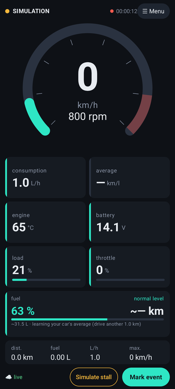
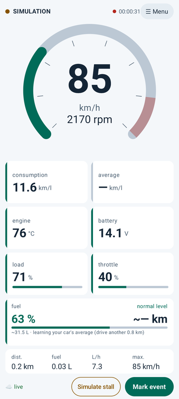
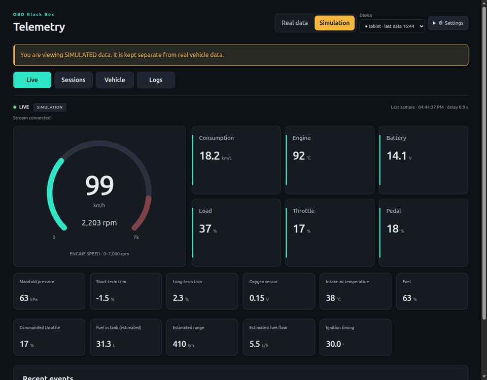

# OBD Black Box

An Android app that turns a phone and a cheap ELM327 Bluetooth adapter into a dashboard, a data logger and a
dash-cam-style black box for any OBD-II car. An optional self-hosted server streams everything live to a web
dashboard, keeps the history and lets you read or clear trouble codes remotely.

It was built to chase an intermittent problem (an engine that stalls when the car stops), so it focuses on
recording what happened right before and after an event, not only on showing gauges.

<p>
  
  
</p>


## Features

**App (works on its own, no server needed)**

- Live dashboard: speed, rpm, consumption (L/h and km/l), engine temperature, battery voltage, load, throttle and
  fuel level, plus every other PID the car answers.
- Fuel range learned from your car's own consumption (no fixed km/l): litres left and kilometres to empty, based on
  a vehicle profile (tank size, engine displacement and fuel).
- Event detection: tells an engine that stalls by itself apart from one switched off with the key, and lets you mark
  an event with one tap while driving.
- Black box: optional screen and microphone recording in 5-minute segments kept for about 2 hours (2 GB at most).
  The 2 minutes before and after every event are saved to the gallery (`Movies/OBD Black Box`). Recordings never
  leave the phone; you decide what to share.
- Diagnostics: stored, pending and permanent trouble codes with descriptions, freeze frame, readiness monitors and
  vehicle identification. Clearing codes asks for confirmation and saves a reading before and after.
- A CSV file per session, a simulation mode to try everything without a car, English and Portuguese, light and
  dark themes (both follow the phone by default).

**Server (optional, self-hosted)**

- Live view of each phone, session history with charts, events, diagnostics and app logs.
- Read diagnostics or clear trouble codes from the browser while the phone is connected to the car.
- Several phones per server: each API key is a device, and the dashboard filters by device.
- Go + PostgreSQL in two containers, with a pluggable login (API key by default, your own SSO through a small Go
  wrapper).

## What you need

- An Android phone with Android 8.0 or newer.
- An ELM327-compatible OBD-II adapter over **Bluetooth Classic or Bluetooth LE** (KONNWEI, Vgate iCar, vLinker,
  OBDLink and most clones work). Wi-Fi adapters are not supported yet.
- A car with an OBD-II port. Most petrol cars sold since 2001 in Europe, 1996 in the US and 2010 in Brazil
  (OBDBr-2) have one. What you see depends on the PIDs your car answers.
- To build: JDK 21 and the Android SDK (or Android Studio). For the server: Docker, or Go 1.27 and PostgreSQL 17.

## Quick start

### 1. Run the server (optional)

```sh
cp .env.example .env
# Edit .env: set API_KEYS (one name:key per phone), COOKIE_SECRET and the database password.
docker compose up --build -d
```

Open <http://localhost:8080> and sign in with one of the keys. Kubernetes manifests, every setting, backups and
custom login are in [docs/self-hosting.md](docs/self-hosting.md).

### 2. Build the app

The server address is fixed **at build time**. Without it you get an app that never uploads anything: the
dashboard, recording, black box and diagnostics all work, and Data → Server says "Server upload disabled in this
build".

```sh
cd android

# Local only: no server, nothing leaves the phone.
./gradlew assembleDebug

# With your server (Gradle property or environment variable; the property wins).
./gradlew assembleDebug -PobdBlackBox.apiUrl=https://obd.example.com
OBD_BLACKBOX_API_URL=https://obd.example.com ./gradlew assembleDebug

adb install -r app/build/outputs/apk/debug/app-debug.apk
```

Use an address the phone can reach (not `localhost`). Plain `http://` is accepted only when the build URL itself
starts with `http://`, which is handy for a test server on your local network:
`-PobdBlackBox.apiUrl=http://192.168.0.10:8080`.

### 3. Connect

1. In the app, open **Menu → Data**.
2. With a server build, paste the API key of this phone in **Server → API key** (or, for debug builds,
   `adb shell am start -S -n io.github.eliasmeireles.obdblackbox/.ui.MainActivity --es api_key <key>`).
3. Plug the adapter into the car, turn the ignition on and tap **OBD adapter → Find devices**. The app lists every
   Bluetooth device nearby, tests the one you pick (connects and asks for the ELM327 identity) and keeps it only if
   it works; otherwise it tells you why and what to try.

To try it without a car, turn on **Simulation mode** in the same screen. Simulated data is labelled as such and
never mixed with real readings, in the app and on the server.

## Safety

- Mount the phone and set things up before driving. Do not operate the app while driving.
- Clearing trouble codes turns the warning lamp off but does not fix anything, resets the readiness monitors (an
  inspection may fail until they complete again) and erases the freeze frame. The app saves a reading first, but
  write the codes down and talk to a mechanic.
- Only standard OBD-II requests are sent (modes 01–0A). The app does not write to the ECU or change its settings.
- Recording the screen and the microphone can be subject to local laws, especially with passengers. It is off by
  default and Android asks for consent every time.

## Privacy

Everything stays on the phone unless you build the app with a server address. In that case it sends the readings,
events, diagnostics (including the VIN, if the car reports it) and app logs to **your** server, authenticated with
the key you configured. Videos are never uploaded.

## Repository layout

| Path | What it is |
|---|---|
| [`android/`](android) | The app (Kotlin, Jetpack Compose). Talks to ELM327 adapters directly over Bluetooth. |
| [`backend/`](backend) | The server (Go, PostgreSQL) and the web dashboard it serves (plain HTML, CSS and JS). |
| [`deploy/k8s/`](deploy/k8s) | Kustomize base for Kubernetes. |
| [`tools/fake-bridge/`](tools/fake-bridge) | A simulated car over TCP, for developing the app without an adapter. |
| [`firmware/`](firmware) | Notes about an ESP32 + CAN bridge (planned), an alternative to the ELM327. |
| [`docs/`](docs) | [Self-hosting](docs/self-hosting.md), [server API](docs/backend-spec.md), [bridge protocol](docs/bridge-protocol.md). |

## Development

```sh
# App: unit tests and debug build
cd android && ./gradlew testDebugUnitTest assembleDebug

# Server: tests (Postgres tests run when TEST_DATABASE_URL is set)
cd backend && go vet ./... && go test -race ./...

# Dashboard: syntax check (no build step)
for f in backend/web/static/*.js; do node --check "$f"; done

# Fake bridge
python3 -m unittest discover -s tools/fake-bridge/tests
```

Issues and pull requests are welcome. When something does not work with your vehicle, please describe the car and the
adapter and attach the app log: the **Logs** tab of the dashboard, or the `elm-*.log` files in
`Android/data/io.github.eliasmeireles.obdblackbox/files/logs` on the phone.

## License

[MIT](LICENSE)
